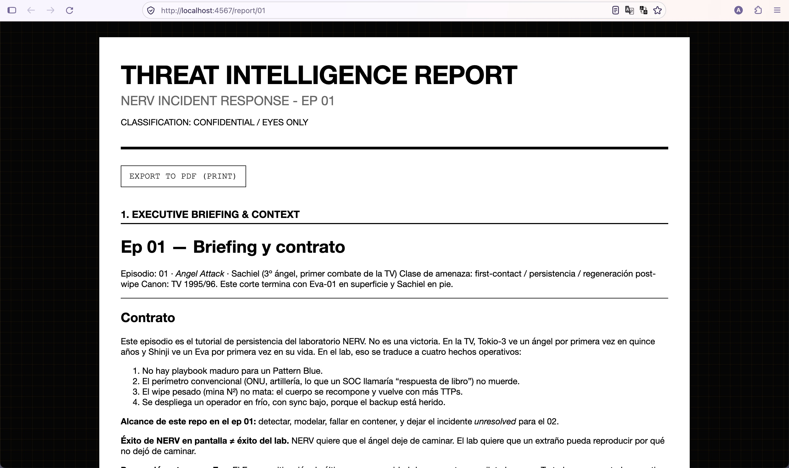
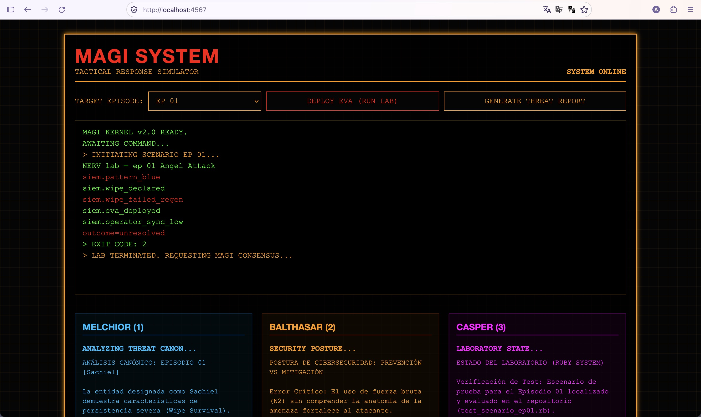

# NERV Cybersec Lab 🛡️🔴

**NERV Cybersec Lab** es un simulador táctico y repositorio de estudio que convierte cada episodio de *Neon Genesis Evangelion* (TV, 1995-1996) en un incidente de ciberseguridad moderno.

En este proyecto, los *Ángeles* no son monstruos de ficción, sino vectores de ataque, malwares adaptativos y vulnerabilidades avanzadas. El laboratorio permite estudiar ciberseguridad simulando prevención, mitigación de daños, y errores humanos, usando **Ruby** ejecutable (Modo CLI) y un **Dashboard Web temático** interactivo.

---

## 🚀 Arquitectura MAGI

El laboratorio está diseñado bajo el modelo de triple consenso de las supercomputadoras de NERV:

- **MELCHIOR (Canon y Amenaza):** Modela el comportamiento real de la amenaza tal cual apareció en la serie (superficie de detección, regeneración frente a explosivos N2, etc.).
- **BALTHASAR (Postura de Seguridad):** Evalúa las defensas. Separa estrictamente lo que es "Prevención" de lo que es "Mitigación" (ej. subir a un niño de 14 años a un robot gigante *no* es prevención, es un fallo crítico y mitigación desesperada).
- **CASPER (Código Ejecutable):** El simulador escrito en Ruby. Contiene tests y lógica de código que recrea la cadena de ataque (Kill-Chain) de cada ángel.

---

## 🛠️ Requisitos del Sistema

- **Ruby 3.x**
- **Bundler** (`gem install bundler`)
- Un navegador web moderno para visualizar la MAGI.

---

## 📦 Instalación

1. **Clonar el repositorio:**
   ```bash
   git clone https://github.com/Andrei-Barwood/nerv-cybersec-lab.git
   cd nerv-cybersec-lab
   ```

2. **Instalar dependencias locales:**
   Se utiliza Sinatra y Kramdown para levantar la interfaz gráfica y procesar los reportes.
   
   *Instalación estándar:*
   ```bash
   bundle config set --local path 'vendor/bundle'
   bundle install
   ```

   *O instalación 100% offline (sin conexión a internet):*
   ```bash
   ./install_offline.sh
   ```

3. **Inicializar la Enciclopedia MAGI (Base de datos de consenso):**
   Genera el diccionario de respuestas y análisis de los 3 núcleos (el script offline lo hace automáticamente).
   ```bash
   ruby lib/magi_web/seed_database.rb
   ```

---

## 💻 Tutorial de Uso

Este laboratorio ofrece dos formas de correr las simulaciones: el modo clásico en terminal (CLI) y el moderno panel gráfico del MAGI.

### Modo 1: Operaciones por Terminal (CLI)

Ideal para desarrolladores y auditoría del código de la Kill-Chain (Casper). Ejecutas cada episodio pasándole por parámetro el número (01 a 26).

**Comando:**
```bash
ruby -Ilib bin/episodio 01
```

**Output esperado:**
Verás la traza del Sistema de Gestión de Información y Eventos de Seguridad (SIEM).
```text
NERV lab — ep 01 Angel Attack
siem.pattern_blue
siem.wipe_declared
siem.wipe_failed_regen
siem.eva_deployed
siem.operator_sync_low
outcome=unresolved
```
*Nota: Un `Exit code 2` (unresolved) es esperado para el Ep 01, ya que la verdadera contención se logra en el modo Berserk del Episodio 02.*

---

### Modo 2: MAGI Web Dashboard (GUI Fandom)

El modo visual oficial para el análisis forense de incidentes y generación de *Threat Intelligence Reports*.





**1. Lanzar el Servidor:**
```bash
bundle exec bin/magi
```

**2. Acceder al Panel Táctico:**
Abre tu navegador en: [http://localhost:4567](http://localhost:4567)

**3. Simular un Incidente:**
- **Canal A (Episodios y C-Level):** Selecciona un episodio (ej. `EP 01`) o amenaza (`YUI`, `REI`, `SHINJI`, `KEEL`), pulsa **DEPLOY EVA (RUN LAB)** o **GENERATE EPISODE REPORT**.
- **Canal B (Ángeles Canónicos TV 01-18):** Selecciona el Ángel táctico en el nuevo menú desplegable (Adam a Lilim), pulsa **ANALYZE ANGEL (RUN LAB)** para ver la telemetría SIEM y el dictamen de los 3 núcleos, o pulsa **GENERATE ANGEL REPORT (PDF)** para abrir el dossier clasificado.

---

## 📄 Generación de Reportes Forenses (PDF)

El proyecto documenta extensamente las vulnerabilidades, errores de los operadores (*Human Factors*), anatomía de la amenaza y *After Action Reports* (AAR) en documentos `.md` (ubicados en `docs/episodios/` y `docs/angeles/`).

Para exportar la documentación completa de un incidente o Ángel como un **Threat Intelligence Report** con formato PDF corporativo:

1. Levanta el servidor del MAGI Dashboard (`./bin/magi_offline` o `bundle exec bin/magi`).
2. Haz clic en el botón **GENERATE THREAT REPORT** (ej. `http://localhost:4567/report/01`) o **GENERATE ANGEL REPORT** (ej. `http://localhost:4567/report/angel/03` o `http://localhost:4567/report/angel/tabris`).
3. El sistema unificará todos los datos (Mecánicas, Espoilers, Auditoría de Vulnerabilidades: *Honeypot de SEELE vs Defecto de Diseño*, Rol de Keel Lorenz y Consenso de los 3 Núcleos MAGI) en una sola hoja web de fácil lectura.
4. Presiona el botón **EXPORT TO PDF (PRINT)** o usa el menú de imprimir de tu navegador. El documento sugerirá automáticamente el nombre seguro de exportación.

---

## 📚 Estructura de Directorios

- `bin/`: Ejecutables del lab (`episodio`, `magi`, `magi_offline`).
- `docs/angeles/`: Dossiers clasificados de cada uno de los 18 Ángeles de la serie de TV (1995-1996).
- `docs/episodios/`: Documentación técnica y forense de cada incidente por episodio.
- `lib/nerv/`: Clases principales del motor Ruby (Ángeles, Vectores de ataque, SIEM, Dossiers).
- `lib/nerv/angels/`: Implementación de los 18 Ángeles canónicos de TV como clases ejecutables.
- `lib/nerv/scenarios/`: Escenarios orquestados por número de episodio.
- `lib/magi_web/`: Aplicación Sinatra para la GUI, estilos (CSS), plantillas ERB y base de datos MAGI.
- `prompts/`: Reglamentos maestros y constituciones usadas para guiar a los agentes IA (*Constitución de NERV*).
- `test/`: Tests unitarios bajo Minitest que aseguran que las mitigaciones "muerden" y que los modelos persisten de forma realista.
